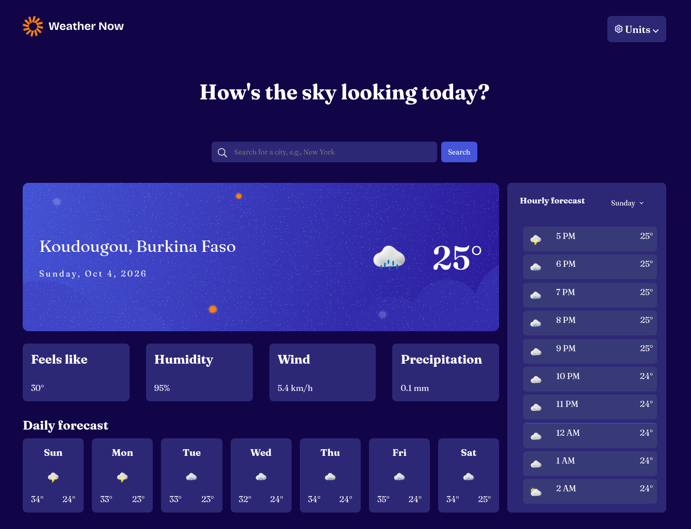
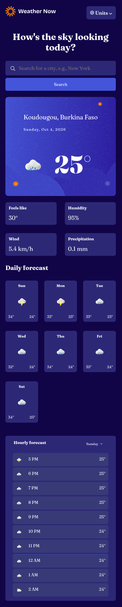

# Frontend Mentor - Weather App Main Page Solution

This project is a responsive weather web application built as a solution to the [Weather app main page challenge on Frontend Mentor](https://www.frontendmentor.io/challenges/weather-app).

It allows users to search for any city in the world, view the current weather, browse a full week of daily forecasts, and explore hour-by-hour data. The app uses the Open-Meteo API for weather data and the Nominatim API for geocoding. It supports metric and imperial units, handles browser history, and provides clear UI states for loading, search progress, empty results, and network errors.

Frontend Mentor challenges help developers improve their coding skills by building realistic projects.

## Table of Contents

* [Overview](#overview)
  * [The Challenge](#the-challenge)
  * [Screenshot](#screenshot)
  * [Links](#links)
* [Getting Started](#getting-started)
* [Project Structure](#project-structure)
* [My Process](#my-process)
  * [Built With](#built-with)
  * [What I Learned](#what-i-learned)
* [Author](#author)

## Overview

### The Challenge

Users should be able to:

* View the optimal layout depending on their device's screen size.
* See the weather of their current location on first load (via the Geolocation API).
* Search for any city and see a live, alphabetically-sorted dropdown of results as they type.
* Select a city from the list and view its current weather.
* Switch between metric and imperial units (°C / °F, km/h / mph, mm / in) at any time, individually or with a single "Switch to Imperial" action.
* View a 7-day daily forecast, starting with today.
* View an hour-by-hour forecast for the current day, starting from the current hour.
* Select any day of the current week from a dropdown and see its hourly forecast.
* See a visual marker when the hourly window crosses midnight into the next day.
* Use the browser back / forward buttons to navigate between previously searched cities.
* Experience clear UI states:
  * **Loading** when the page first opens or a city is loading.
  * **Search in progress** while a search request is running.
  * **No search result found** when the searched place doesn't exist.
  * **Something went wrong** when the network is unavailable, with a Retry button.
* See hover, focus and disabled states on all interactive elements.

### Screenshot




### Links

* Solution URL: [Frontend Mentor solution](https://www.frontendmentor.io/)
* Repository URL: [GitHub repository](https://github.com/bigmum0a-wq/weather-app-main)
* Live Site URL: [Weather App](https://bigmum0a-wq.github.io/weather-app-main/)

## Getting Started

### Run the Project Locally

To run this project locally:

1. Clone this repository:

   ```bash
   git clone https://github.com/bigmum0a-wq/weather-app-main.git
   ```

2. Navigate to the project directory:

   ```bash
   cd weather-app-main
   ```

3. Open the application. The frontend is located in:

   ```text
   index.html
   ```

You can open the file directly in your browser or use a local development server such as the VS Code Live Server extension.

> ⚠️ The Geolocation API requires a secure context (`https://` or `localhost`). Opening the file directly with `file://` will prevent the automatic location detection. Use a local server instead.

## Project Structure

```text
weather-app-main
│
├── README.md
│
├── index.html
│
└── assets
    │
    ├── css
    │   └── styles.css
    │
    ├── designs
    │   ├── image-desktop-state.png
    │   └── image-mobile-state.png
    │
    ├── fonts
    │   └── fraunces
    │       ├── Fraunces-Italic-VariableFont_SOFT,WONK,opsz,wght.ttf
    │       ├── Fraunces-VariableFont_SOFT,WONK,opsz,wght.ttf
    │       └── OFL.txt
    │
    ├── images
    │   ├── bg-today-large.svg
    │   ├── bg-today-small.svg
    │   ├── favicon-32x32.png
    │   ├── icon-checkmark.svg
    │   ├── icon-drizzle.webp
    │   ├── icon-dropdown.svg
    │   ├── icon-error.svg
    │   ├── icon-fog.webp
    │   ├── icon-loading.svg
    │   ├── icon-overcast.webp
    │   ├── icon-partly-cloudy.webp
    │   ├── icon-rain.webp
    │   ├── icon-retry.svg
    │   ├── icon-search.svg
    │   ├── icon-snow.webp
    │   ├── icon-storm.webp
    │   ├── icon-sunny.webp
    │   ├── icon-units.svg
    │   └── logo.svg
    │
    └── js
        └── js.js
```

## My Process

### Built With

* Semantic HTML5 markup
* CSS custom properties
* CSS Flexbox and Grid
* CSS animations (`@keyframes`)
* Responsive design with media queries

* Pure JavaScript
  * DOM manipulation
  * Event listeners (click, input, submit, popstate)
  * Debouncing (300 ms) for the search input
  * `async` / `await` and Promises
  * `Promise.all()` for parallel requests
  * Fetch API
  * Geolocation API
  * History API (`pushState`, `popstate`)
  * Date formatting with `toLocaleDateString`
  * Object and array methods (`map`, `find`, `slice`, `flatMap`, `forEach`)
  * State management with a single `state` object
  * UI state machine (loading, search-progress, no-result, error, normal)
  * WMO weather code → icon mapping

* External APIs
  * [Open-Meteo](https://open-meteo.com/) — weather forecast data
  * [Nominatim (OpenStreetMap)](https://nominatim.org/) — geocoding and reverse geocoding
  * Browser Geolocation API — for the initial location

* GitHub Pages for deployment

### What I Learned

Building this project helped me understand how to manage a real application state and how to coordinate multiple asynchronous requests that depend on each other.

I practiced building a complete data flow, from user input to visible output:

1. **State management** — Instead of reading values directly from the DOM, all decisions come from a single `state` object (`location`, `weather`, `selectedDay`, `units`, `ui`, `lastAction`). The DOM becomes a mirror of `state`, never the source of truth.

2. **Week windowing** — Instead of asking the API for a fixed number of days, the app calculates the position of today inside the current week (`(getDay() + 6) % 7`) and requests exactly the range needed (`past_days=i&forecast_days=7`). This keeps the calendar coherent no matter which day the user opens the app.

3. **Data normalization** — Open-Meteo returns parallel arrays (`daily.time`, `daily.temperature_2m_max`, etc.). I learned to transform them into an array of clean day objects, each carrying its own 24 hours, its label, its status (`past` / `current` / `future`), and its icon.

4. **Single fetch vs local re-render** — Fetching again for a city change or a unit change, but re-rendering locally for a day change. Knowing which action invalidates cached data and which doesn't.

5. **UI state machine** — A single `showState(name)` function toggles between five states without duplicating logic. Every async flow knows exactly which state to display on success and on failure.

6. **Units and re-fetch** — When the user switches units, the API is queried again with the proper parameters (`temperature_unit`, `wind_speed_unit`, `precipitation_unit`). This avoids doing unit math in JavaScript and keeps values accurate.

7. **Browser history** — Using `history.pushState()` on successful searches and `popstate` to re-fetch on back / forward navigation, giving the app a native "back" behavior.

8. **Error handling** — Distinguishing between "no result" (a valid empty response) and "network error" (a failed request), and routing each to the correct UI state.

9. **Accessibility** — Using `aria-expanded` on dropdowns, `aria-label` on icon buttons, and keeping keyboard focus visible.

10. **Responsive design** — Reorganizing the layout on mobile: stacked search form, 2-column extra cards, 3-column daily grid, and a full-width hourly section below.

## Author

* Frontend Mentor - [@bigmum0a-wq](https://www.frontendmentor.io/profile/bigmum0a-wq)